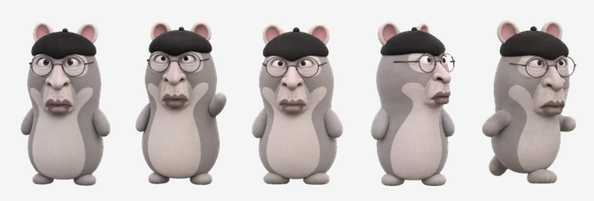

# Faker 小飞鼠 · 桌宠

一只运行在 Windows 桌面上的 **Faker 飞天鼠** 桌宠。待机时安静呼吸、眨眼；鼠标靠近时扭头注视；单击挥手、双击跳跃、拖动时迈腿奔跑。无需联网，本地运行。



## 特性

- 🖱️ **注视鼠标** —— 鼠标移到身上，头部平滑转向鼠标所在方向（16 个方向）
- 👋 **单击挥手**、🤸 **双击跳跃**、🏃 **拖动奔跑**（带倾斜与落地弹跳）
- 🖥️ **全屏自动隐藏** —— 前台应用进入全屏时自动隐藏，退出后原位恢复
- 📐 三档大小、窗口置顶、多屏拖拽、位置记忆、系统托盘常驻
- 🎨 素材直接取自 Faker 的 Codex 精灵图集，未做重绘

## 快速开始

1. 下载仓库中的 `Faker飞鼠桌宠.exe` 和 `spritesheet.png`，放到**同一个文件夹**。
2. 双击 `Faker飞鼠桌宠.exe` 启动。
3. 右键飞鼠或任务栏托盘图标打开菜单。

> 运行环境：Windows 10 / 11 自带的 .NET Framework 4.x，无需安装、无需联网。

## 交互说明

| 操作 | 效果 |
| --- | --- |
| 待机 | 播放待机动画，自然呼吸、眨眼 |
| 鼠标移到身上 | 头部转向鼠标方向；移开后恢复 |
| 单击 | 挥手打招呼 |
| 双击 | 兴奋跳跃 |
| 按住左键拖动 | 朝移动方向奔跑，随方向倾斜；松手弹跳落地 |
| 所在屏幕进入全屏 | 自动隐藏；退出全屏后原位恢复 |

右键菜单支持：跳跃 / 挥手 / 沮丧、大小（小·标准·大）、总在最上面、全屏时自动隐藏、回到右下角、退出。

详细说明见 [使用说明.txt](使用说明.txt)。

## 目录结构

```
Faker小飞鼠/
├── Faker飞鼠桌宠.exe   主程序
├── spritesheet.png     素材（运行必需）
├── pet.json            素材元数据
├── 使用说明.txt         使用说明
├── 预览.png            形象预览
├── LICENSE             MIT（软件与构建配置）
├── ARTWORK-NOTICE.md   插画版权声明（必读）
└── 源码/               C# 源码与构建脚本
```

## 从源码构建

```bat
cd 源码
build.cmd
```

使用 .NET Framework 4.x 自带的 `csc.exe` 编译，产物输出到上级目录的 `Faker飞鼠桌宠.exe`。

## 版权声明

- **软件代码**：MIT License，见 [LICENSE](LICENSE)。
- **插画素材**（`spritesheet.png` 及其角色形象）：**不在 MIT 许可范围内**，仅限个人观赏与实验，未授予商业使用或再分发许可。请务必阅读 [ARTWORK-NOTICE.md](ARTWORK-NOTICE.md)，在转载、再分发或商用前取得相关授权。

本项目由 [Naiwa 桌宠](https://github.com/yugh6) 的框架改造而来，插画为 Faker / 飞天鼠梗的同人创作。
